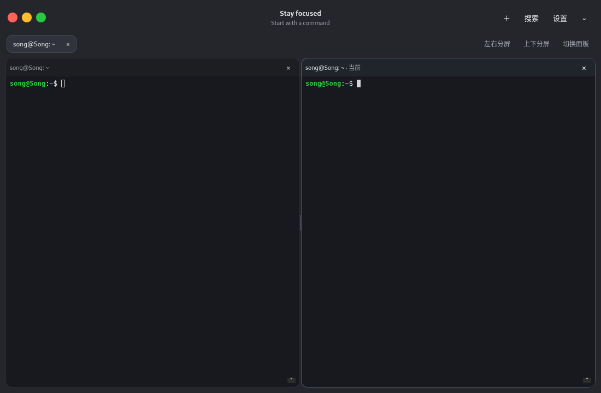

# Windows / Linux 独立终端

`desktop/` 是默认独立版本，应用名为 **terminal**。安装包包含 Electron、xterm.js 和原生 node-pty；终端内运行真实 shell。原有 `bin/mac-style-terminal` GTK 启动器继续保留。SSH 当前暂停。

## 系统和架构

| 平台 | 目标范围 | 原生 CI 环境 |
| --- | --- | --- |
| Windows x64 | Windows 10 1809+、Windows 11 | windows-2022 x64 |
| Windows ARM64 | Windows 10 1903+、Windows 11 | windows-11-arm ARM64 |
| Linux x64 | Debian / Ubuntu、Fedora、Arch、openSUSE 的受支持桌面版本 | ubuntu-22.04 x64 |
| Linux ARM64 | 上述发行版的 ARM64 桌面版本 | ubuntu-24.04-arm ARM64 |

Windows 使用 ConPTY，所以不能支持更早的 Windows。默认优先使用已安装的 PowerShell 7，否则使用 Windows PowerShell；外观设置可选择 cmd。Windows 10 的范围是兼容性目标，CI 的 Windows Server / Windows 11 运行结果不能替代 Windows 10 实机验证。

Linux 的保守验证基线是 x64 Ubuntu 22.04、ARM64 Ubuntu 24.04；本地集成验证在 Debian 13 x64 进行。Fedora、Arch 和 openSUSE 是交付目标，尚未逐个实机验证。不要把 AppImage 视为可运行在任意旧发行版上的保证：[Electron 官方平台支持](https://github.com/electron/electron/blob/main/README.md#platform-support)要求发行版版本同时受 Chromium 与发行版维护者支持。较旧 glibc、桌面库或 sandbox 配置可能不兼容，应使用受支持的系统版本。应用需要图形桌面、系统 shell、GTK3/NSS/GBM/ALSA 等 Electron 系统运行库；deb/rpm 包通过发行版包管理器安装依赖。

## Windows 安装、启动和卸载

下载对应 `x64` 或 `arm64` 的 `terminal-<版本>-windows-<架构>-setup.exe`，按提示选择安装目录。安装为当前用户，不需要管理员权限，并建立开始菜单和桌面快捷方式。安装器使用 [electron-builder NSIS 配置](https://www.electron.build/docs/nsis/)。当前构建未签名，Windows 可能显示 SmartScreen 提示。

在“设置 → 应用 → 已安装的应用”卸载 terminal，或运行安装目录内的卸载器。卸载移除程序和快捷方式，保留设置与已导入的壁纸，重新安装可恢复使用。zip 版本解压到当前用户可写目录，双击 `terminal.exe`；删除解压目录即移除程序，设置仍保留。zip 版本仍使用用户配置目录，并非把设置放进 zip 文件夹。

## Linux 安装、启动和卸载

选择对应架构的文件；deb 的 x64 对应 amd64，ARM64 对应 arm64，rpm 的 ARM64 通常显示 aarch64。

AppImage 无需安装：

```bash
chmod +x terminal-*-linux-*.AppImage
./terminal-<版本>-linux-<架构>.AppImage
```

AppImage 可能需要发行版的 FUSE 2 兼容库（例如 Ubuntu 22.04 的 `libfuse2`、Ubuntu 24.04 的 `libfuse2t64`）。没有 FUSE 时可解压运行：

```bash
./terminal-<版本>-linux-<架构>.AppImage --appimage-extract
./squashfs-root/AppRun
```

使用普通桌面用户运行应用，系统必须允许 Chromium sandbox。AppImage 删除文件即可卸载；解压版删除 `squashfs-root`。AppImage 不自动安装应用菜单入口。

Debian / Ubuntu：

```bash
sudo apt install ./terminal-<版本>-linux-<架构>.deb
terminal
sudo apt remove terminal
```

Fedora 使用 `sudo dnf install ./terminal-<版本>-linux-<架构>.rpm`，卸载用 `sudo dnf remove terminal`；openSUSE 使用 `sudo zypper install ./terminal-<版本>-linux-<架构>.rpm`，卸载用 `sudo zypper remove terminal`。Arch 使用 AppImage 或解压版。deb/rpm 安装后可从应用菜单或 `terminal` 启动。

Linux 继续读取 `~/.config/mac-style-terminal/settings.json` 和已有壁纸；Windows 使用 Electron 用户配置目录（通常 `%APPDATA%\\terminal`）。卸载保留配置。用户名与主机名颜色支持 Bash 和 PowerShell；其他 shell 使用自身的提示符配置。导入壁纸复制到应用管理的存储目录，移除壁纸只删除应用的副本，保留原始图片。

## 复制和粘贴

终端支持 `Ctrl+Shift+C` / `Ctrl+Shift+V` 和右上角“更多操作”中的复制、粘贴、全选。也可用 `Ctrl+V` 粘贴；`Ctrl+C` 在选中文字时复制，没有选区时中断当前命令。没有选区的复制操作保留剪贴板原内容。菜单操作完成后焦点返回终端，可以直接继续输入或按 Enter。搜索框、设置和重命名输入框使用原生 `Ctrl+C` / `Ctrl+V`。

## 分屏

标签栏下方的“左右分屏”和“上下分屏”会拆分当前面板，并在新面板运行独立的本地 shell，继承当前面板所在目录。可继续嵌套拆分；点击面板或“切换面板”改变输入焦点。复制、粘贴、搜索均作用于当前面板，外观设置应用于全部面板。



拖动分隔线调整比例；分隔线也可用 Tab 聚焦，再按方向键每次调整 5%，Home / End 调整至 15% / 85%。空间不足时会提示放大窗口或调整比例。最多嵌套 8 层，全部标签页共用最多 40 个终端会话的限制。

| 操作 | 快捷键 |
| --- | --- |
| 左右分屏 | Ctrl+Shift+H |
| 上下分屏 | Ctrl+Shift+J |
| 切换到下一个面板 | Ctrl+Shift+O |
| 关闭当前面板 | Ctrl+Shift+X |
| 关闭整个标签页 | Ctrl+Shift+W |

面板标题右侧的 × 关闭该面板，剩余面板自动填补空间；单独关闭忙碌面板时确认。关闭标签页始终统一确认一次，包括空闲会话；取消后该标签页及所有分屏保持运行。关闭最后一个面板沿用标签页关闭行为，确认后打开新的本地会话。B 版面板使用 12px 圆角、2px 接缝，拖动区域扩展到 12px。正常关闭后布局不保留；异常退出后可在下次启动时选择恢复。

## 异常退出恢复（0.4.0 起）

每个窗口在配置目录的 recovery 子目录写入独立检查点。布局、焦点、标签名称和顺序变化后约 200ms 保存，并每 1.5 秒核对当前目录；内容未变时不重复写盘。主进程从实际会话补全 cwd 与 Shell，记录不包含命令、屏幕输出或密码。

强制结束主进程、渲染进程崩溃或系统意外退出后，新启动窗口会提示恢复最近一份异常退出记录。选择“恢复会话”会启动新 Shell，恢复标签、分屏与目录；原进程、历史输出、未提交输入和临时环境变量不会恢复，命令不自动重跑。目录/Shell 缺失时回退到主目录或默认 Shell，并显示结果。正常退出清除当前窗口记录；尚未回答恢复提示便关闭窗口，或在提示中按 Esc，不会丢弃原记录。只有明确选择“新建终端”才放弃本次候选。

活跃窗口通过 PID 与进程启动身份区分，避免 PID 复用和重启后的误判。多个异常窗口每次提供最近一份，其他检查点保留。恢复记录有 40 会话/8 层限制及结构校验，损坏记录被忽略；POSIX 文件使用 0600 权限。写入以临时文件、文件同步与原子重命名提交，目录同步在支持的平台尽力执行。不能承诺在断电、存储硬件故障或写盘失败时保住最新变更。

本功能从 0.4.0 开始提供。

## 自定义快捷键（0.4.0 起）

通过“更多操作 → 快捷键设置…”或外观设置中的同名入口，录入、清除或恢复 19 个终端操作的快捷键。保存后立即生效并写入已有的 settings.json 中的 shortcuts 字段；旧配置自动使用默认快捷键，损坏的快捷键配置回退到默认值。快捷键只在应用内生效，不注册全局系统热键。

普通字符需搭配 Ctrl、Alt 或 Meta；纯功能键可直接绑定。冲突、无效组合及常见系统保留组合会提示并阻止保存，Ctrl+C / Ctrl+V 固定别名保留。录入过程不执行应用命令；Esc 取消录入，Tab 结束录入并继续导航，Delete / Backspace 清除。恢复默认需保存，取消不会改变已保存的配置。

清除“关闭面板或退出”后，终端内 Esc 由 shell / 前台程序处理；弹窗、菜单和搜索中的 Esc 取消行为保留。外观预览期间保存快捷键不会保存其他外观草稿，取消外观设置也不会撤销已保存的快捷键。快捷键设置独立保存不会清理当前预览的壁纸文件。

以下 Esc 关闭说明描述默认绑定；自定义后以快捷键设置为准。此功能从 0.4.0 开始提供。

## Esc 关闭

单独按 `Esc` 时，先取消最上层的设置、重命名、关于窗口或菜单；没有弹窗和菜单时关闭搜索栏，再次按下关闭当前面板。单面板标签页会关闭标签页；最后一个标签页的最后一个面板关闭时退出整个终端。关闭标签页及退出窗口始终要求确认，取消则保留会话；单独关闭忙碌面板时也会确认。取消外观设置会恢复预览前的外观，关闭弹窗或搜索后可继续在终端输入。长按 Esc 不会连续关闭多个面板。

Esc 用于应用关闭操作；在 Vim 等依赖 Esc 的终端程序中也会触发关闭确认。

## 从源码构建和验证

需要 Node.js 22、npm、Python 和本平台的 C++ 编译工具。Linux 使用 build-essential 和 rpm；Windows 使用 Visual Studio Build Tools 的 C++ 桌面工具与 Windows SDK，ARM64 构建需要 ARM64 工具链。各架构在对应原生机器构建，Windows 包也在 Windows 构建。

```bash
cd desktop
npm ci
npm test
npm run build
npx electron-builder install-app-deps
npm run test:e2e
npm run pack
# Linux 当前架构
npm run dist:linux -- --x64
# Windows 当前架构（ARM64 使用 --arm64）
npm run dist:win -- --x64
```

`build` 使用 esbuild 把 renderer JS 打包为浏览器脚本，并复制 xterm CSS；`pack` 生成未封装应用目录；`dist:linux` 生成 AppImage/deb/rpm，`dist:win` 生成 NSIS/zip，输出均在 `desktop/dist/`。`npm start` 启动开发应用。构建配置列出安装包格式，架构由命令行选择。发布时显式指定当前原生架构：`--x64` 只生成 x64，`--arm64` 只生成 ARM64。CI 每个 runner 仅构建与本机匹配的架构。

node-pty 的 `.node` 文件必须与目标系统和架构匹配。`install-app-deps` 和打包流程会为 Electron 重建原生依赖。当前 node-pty 使用 Node-API，服务测试也可直接用系统 Node；切换架构或升级原生依赖后应重新构建并检查运行时兼容性。Linux 无显示环境使用 `xvfb-run -a npm run test:e2e`。应用无需 root，也不应关闭 sandbox。

Bash / PowerShell 启动脚本与原生 PTY 模块解包在 `resources/app.asar.unpacked/` 中，系统 shell 可直接读取。打包后再次运行界面测试，防止开发模式通过而安装包失效。

`.github/workflows/desktop.yml` 在四种匹配的原生 runner 上执行 `npm ci`、服务测试、Electron PTY/ConPTY 端到端测试，再打包、对打包后的可执行文件重复回归测试，最后上传产物。工作流配置存在不表示远端测试已执行通过；Windows / ARM64 的实际结果应以对应 CI 记录为准。本地 Linux 验证不能证明 Windows 或 ARM64 已通过。

本次构建与实测结果见 [跨平台验证记录](cross-platform-verification.md)。
